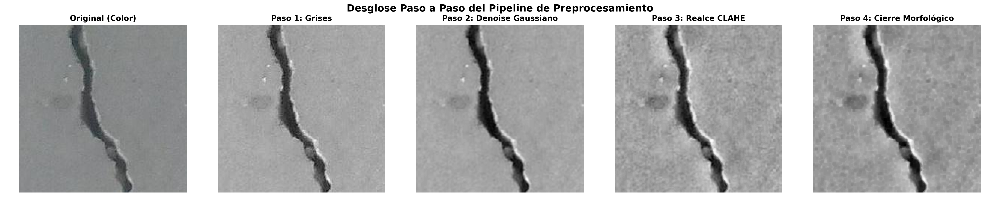
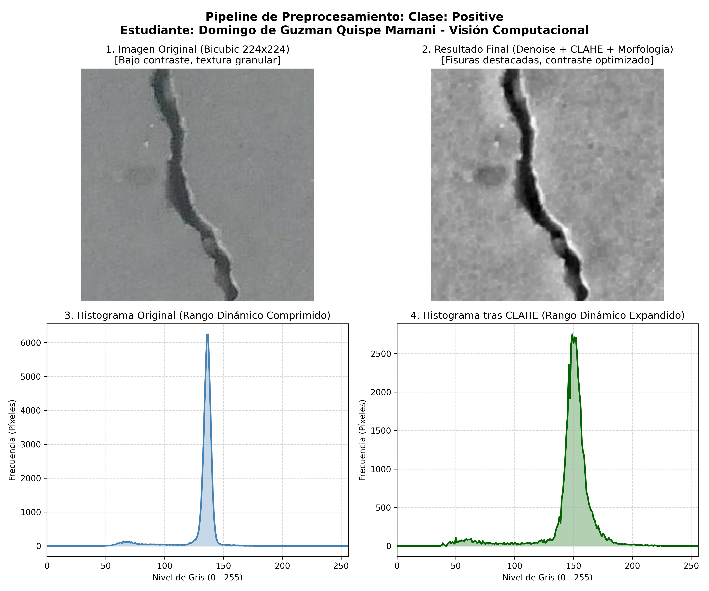
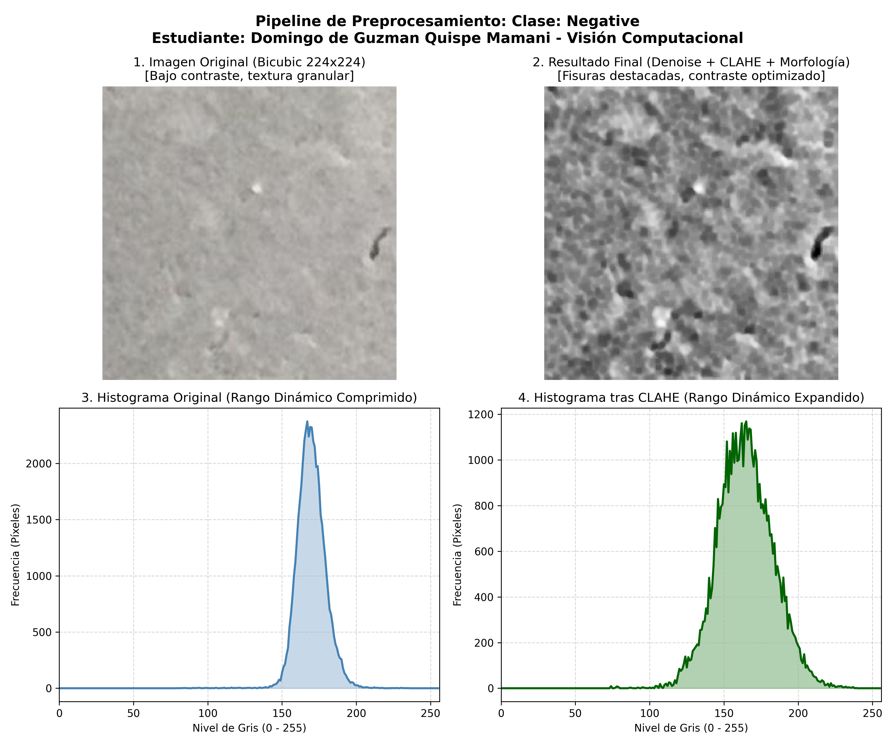

# Proyecto Semestral: Preprocesamiento de Dataset de Imágenes
## Detección y Clasificación de Grietas en Superficies de Concreto

* **Asignatura:** Visión Computacional  
* **Institución:** Universidad Nacional de San Antonio Abad del Cusco (UNSAAC)  
* **Estudiante:** Domingo de Guzman Quispe Mamani  
* **Entrega:** Fase 1 — Selección y Preprocesamiento del Dataset de Imágenes  

---

## 1. Descripción del Problema y Justificación del Dataset

La detección automática de fisuras y fallas en estructuras civiles (puentes, columnas, pavimentos, muros de contención) es una de las aplicaciones más críticas de la **inspección visual computacional**. 

Para este proyecto se seleccionó el dataset **"Concrete Crack Images for Classification"** (Özgenel & Sorguç).

### ¿Por qué es un dataset desafiador?
A diferencia de datasets sintéticos o de estudio con fondos planos:
1. **Ruido de textura de alta frecuencia:** La porosidad natural, piedras, arena y rugosidad del concreto generan artefactos visuales que se confunden fácilmente con micro-fisuras.
2. **Bajo contraste tonal:** La diferencia de nivel de gris entre el interior de una grieta y el concreto circundante suele ser mínima y concentrada en un rango dinámico muy estrecho.
3. **Variaciones de iluminación y sombras:** Las imágenes tomadas en entornos exteriores reales presentan gradientes de iluminación, manchas de humedad y sombras proyectadas.
4. **Discontinuidad estructural:** Las fisuras reales presentan interrupciones por suciedad o desgaste, lo que exige técnicas morfológicas para preservar su conectividad.

---

## 2. Origen del Dataset

* **Nombre oficial:** Concrete Crack Images for Classification
* **Clases:**
  * `Positive`: Superficie con grietas estructurales.
  * `Negative`: Superficie de concreto sana / sin grietas.
* **Descarga automatizada:** Integrado mediante la librería oficial `kagglehub`:
  ```python
  import kagglehub
  path = kagglehub.dataset_download("arnavr10880/concrete-crack-images-for-classification")
  ```

---

## 3. Arquitectura del Pipeline de Preprocesamiento

El pipeline implementado en [`preprocessor.py`](preprocessor.py) aplica de manera sistemática los conceptos fundamentales de la materia:

```
[Imagen Entrada BGR]
        │
        ▼
1. Remuestreo Geométrico (cv2.resize a 224x224 con Interpolación Bicúbica)
        │
        ▼
2. Reducción Tonal (cv2.cvtColor a Escala de Grises)
        │
        ▼
3. Atenuación de Ruido (Filtro Gaussiano 3x3 / Bilateral para suavizar textura granular)
        │
        ▼
4. Realce de Contraste Local (CLAHE - Clip Limit: 2.5, Grid: 8x8)
        │
        ▼
5. Refinamiento Morfológico (Cierre Morfológico con Elemento Estructurador Rectangular 3x3)
        │
        ▼
6. Normalización de Intensidad ([0, 255] / Flotante [0.0, 1.0])
```

### Fundamentación Técnica de cada etapa:
* **Interpolación Bicúbica:** Preserva la continuidad de bordes finos durante el escalado, evitando los artefactos de bloque de la interpolación por vecino más cercano.
* **Filtro Gaussiano:** Atenúa las imperfecciones puntuales de la superficie sin destruir las líneas dominantes de la grieta.
* **CLAHE (Contrast Limited Adaptive Histogram Equalization):** A diferencia de la ecualización global tradicional (que sobreamplifica el ruido en zonas homogéneas), CLAHE divide la imagen en bloques locales ($8 \times 8$) y limita la ganancia de contraste, revelando el trazo de la grieta incluso bajo sombras.
* **Cierre Morfológico ($A \bullet B = (A \oplus B) \ominus B$):** Aplica una dilatación seguida de una erosión para rellenar pequeñas brechas e interrupciones en la fisura, consolidándola como un objeto continuo.

---

## 4. Resultados y Evidencia Visual

### 4.1. Desglose Paso a Paso del Pipeline


### 4.2. Análisis Comparativo e Histograma (Clase Positiva - Con Grieta)
Se observa claramente cómo el histograma original (comprimido en tonos medios) es expandido y regularizado por CLAHE, haciendo que los valles oscuros de la grieta se diferencien nítidamente del fondo.


### 4.3. Análisis Comparativo e Histograma (Clase Negativa - Sin Grieta)
En superficies sanas, el pipeline homogeniza la textura sin inventar falsos bordes.


---

## 5. Estructura del Repositorio

```text
proyecto_preprocesamiento/
│
├── dataset_muestra_original/     # Muestra representativa balanceada sin procesar
│   ├── Positive/
│   └── Negative/
│
├── dataset_preprocesado/        # Imágenes resultantes tras el pipeline
│   ├── Positive/
│   └── Negative/
│
├── reportes_visuales/           # Gráficas e histogramas de soporte para la exposición
│   ├── comparativa_positive.png
│   ├── comparativa_negative.png
│   └── desglose_paso_a_paso.png
│
├── preprocessor.py              # Clase modular ConcreteCrackPreprocessor
├── procesar_dataset.py          # Script principal de ejecución y muestreo
├── generar_reporte_visual.py    # Script para generar gráficos e histogramas
├── requirements.txt             # Dependencias del entorno
└── README.md                    # Documentación formal de la entrega
```

---

## 6. Instrucciones de Ejecución

1. **Instalar dependencias:**
   ```bash
   pip install -r requirements.txt
   ```

2. **Ejecutar el pipeline de procesamiento y generar reportes:**
   ```bash
   python procesar_dataset.py
   ```

---

## 7. Conclusiones de la Entrega

1. El pipeline implementado reduce exitosamente el ruido de textura sin comprometer los bordes críticos de las fisuras.
2. La ecualización CLAHE resolvió el problema del bajo contraste intrínseco del concreto, produciendo un histograma distribuido que facilitará enormemente las etapas posteriores de extracción de características o entrenamiento de modelos de Deep Learning.
3. El dataset procesado quedó estandarizado a resolución $224 \times 224$, listo para ser utilizado en las fases siguientes del proyecto semestral.
